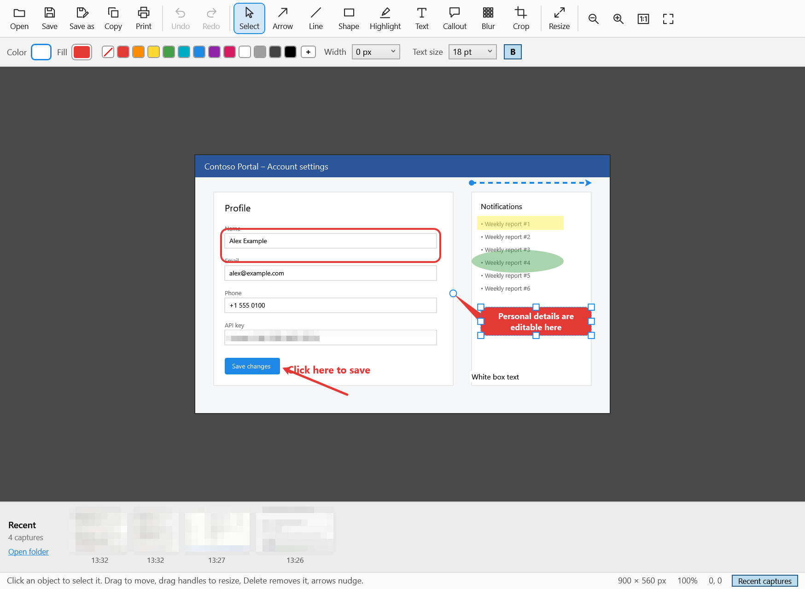

# SnapTool

A small, lightweight screenshot and markup tool for Windows 11: region, window and full-screen capture, a manual
scrolling capture that stitches long pages as you scroll, and a simple editor (arrows, shapes, text, callouts, blur, crop, resize, print).
C# / .NET 8 (WPF + a WinForms capture overlay), no third-party packages. It idles at about 100 MB committed memory and 0% CPU.



## Download and install

Get the latest version from the [Releases page](https://github.com/NishantKhatri1983/SnapTool/releases/latest):

- **SnapTool-Setup-x.y.z.exe**: normal installer. No admin rights needed; adds a Start menu entry, an uninstaller and (optionally) start with Windows.
- **SnapTool.exe**: portable, just run it.

> **Requires the Microsoft .NET 8 Desktop Runtime (x64)**, installed separately:
> [download it from Microsoft](https://dotnet.microsoft.com/download/dotnet/8.0) (choose *.NET Desktop Runtime* → Windows *x64*).
> A newer .NET Desktop Runtime (9, 10, …) works too. The installer checks for it and offers the link if it's missing.

The files aren't code-signed, so Windows SmartScreen may say *Windows protected your PC* the first time. Click *More info* → *Run anyway*.

## Build from source

Needs Windows 10/11 and the [.NET 8 SDK](https://dotnet.microsoft.com/download/dotnet/8.0).

```
dotnet build -c Release
bin\Release\net8.0-windows\SnapTool.exe
```

`installer\build.ps1` builds the release files (portable exe and installer); the installer step needs [Inno Setup 6](https://jrsoftware.org/isdl.php).

SnapTool sits in the notification area. Left-click the icon to capture, right-click it for the menu.

| Command line | Does |
|---|---|
| `SnapTool.exe` | Start the tray app |
| `SnapTool.exe --capture` | Start and capture immediately |
| `SnapTool.exe picture.png` | Open just the editor on a file |
| `SnapTool.exe --selftest [folder]` | Automated checks (scroll stitching, editor tools, crop, resize, undo) |

## Capturing

Press **Ctrl+Shift+S**. The screen freezes under a dimmed overlay:

- **Drag** to capture a region
- **Click** to capture the highlighted window (or the monitor when over the desktop)
- **F** / **Enter** captures the whole monitor
- **S** switches to scrolling capture (see below)
- **Arrow keys** move the cursor 1 px (Shift = 10 px). **Esc** or right-click cancels

### Scrolling capture

Press **Ctrl+Shift+Alt+S** (or **S** in the capture overlay), then click the window or drag the area to capture.
A thin frame marks the area and a small panel appears next to it. **You scroll**: mouse wheel, dragging the scrollbar, arrow or Page keys,
down or back up. SnapTool watches the area and adds new content as it appears, and the panel shows the height so far.
Press **Enter** or **End** (or click *Done*) when you have what you want, or **Esc** to cancel. The result is copied and saved like any capture.

- Fixed parts such as title bars, toolbars, sticky headers and footers appear once, not repeated.
- If you jump further than one screen at once (for example by flinging the scrollbar, or flicking the wheel hard in a
  browser that speeds up fast wheel turns), the panel says *Lost track – scroll back a little*.
  Scroll back until it overlaps what was already captured and it continues.
- Stretches with nothing to match, such as a blank gap taller than the area or many identical rows, are scrolled past
  at your recent speed. When there's really nothing to go on, SnapTool stops adding rows rather than guessing, so the
  result can miss part of such a stretch, but it never puts content in the wrong order.
- While the session runs, Enter, End and Esc go to SnapTool, not to the app you're scrolling.
- The old automatic mode (SnapTool scrolls with the mouse wheel) is still available: Settings → Scrolling capture → *How it scrolls*.

After a capture the image is **copied to the clipboard** (as bitmap and PNG) and **saved** to
`Pictures\SnapTool\Snap_<date>_<time>.png`. A notification appears, and clicking it opens the editor.
You can also use the tray menu: *Open last capture in editor*, *Recent captures*, or *Open image in editor…*.

## Editor

Tools (shortcut): Select (V), Arrow (A), Line (L), Shape (R: rectangle, rounded or ellipse, optional fill),
Highlight (H: rectangle, rounded or ellipse), Text (T), Callout (C), Blur (B, pixelate), Crop (K).

- Every object stays editable. Click it to select, drag to move, use the handles to resize, **Delete** removes it, and arrow keys nudge it.
- The style bar applies to the selected object, or to the next one you draw: color, fill (click the *Fill* well, then a swatch,
  where the crossed swatch means none), width, line **start/end caps** (none, arrow, dot, square), dashed, shape, text size, bold, and blur strength.
- **Shift** snaps lines to 45° and makes shapes square. Double-click text or a callout to edit it, and Ctrl+Enter or Esc finishes.
- **Crop**: drag the area to keep, adjust the handles (arrows nudge), then press Enter or double-click.
- **Resize** (Ctrl+R): pixels or a percentage. Markup scales with the image.
- **Copy** Ctrl+C · **Save** Ctrl+S (overwrites the capture file) · **Save as** F12 · **Print** Ctrl+P · **Undo/Redo** Ctrl+Z / Ctrl+Y
- Zoom with Ctrl+wheel, Ctrl+0 (fit) and Ctrl+1 (100%).
- **Recent captures timeline** along the bottom shows thumbnails of the newest captures in the save folder and updates live.
  Click one to open it in this window, Ctrl+click opens a new window, **PageUp/PageDown** steps to the newer/older capture,
  drag a thumbnail into Teams, Outlook or Explorer to attach the file, and right-click for *Copy image*, *Show in folder* or *Delete (to Recycle Bin)*.
  The *Recent captures* button in the status bar hides or shows it.

## Customizing

Tray menu → **Settings…** (or the gear button in the editor) opens the settings window:

- **Hotkeys**: click a box and press the combination you want. It's checked for conflicts with other apps as you type, and your hotkeys are paused while the window is open. Backspace or *Clear* turns a hotkey off.
- **After a capture**: copy, auto-save, open the editor, notification.
- **Saving**: folder (Browse…), file name pattern with a live preview, PNG/JPG, JPG quality.
- **Editor**: starting tool, what Ctrl+S does, unsaved-changes prompt, remembered tool styles, recent captures timeline.
- **Capture screen**: magnifier, how much to dim, selection color. **Scrolling capture**: scroll to top first, maximum height, wait after each scroll.
- **General**: start SnapTool when you sign in to Windows.

Everything is stored in `%APPDATA%\SnapTool\settings.json`. The palette, tool shortcut keys and per-tool styles are only in that file
(tray menu → *Edit settings.json (advanced)…*), and hand edits apply as soon as you save the file. All the keys:

| Setting | Default | Meaning |
|---|---|---|
| `CaptureHotkey` / `ScrollCaptureHotkey` | `Ctrl+Shift+S` / `Ctrl+Shift+Alt+S` | Any `Ctrl/Shift/Alt/Win + key`, or `PrintScreen`. Empty disables it |
| `CopyToClipboard`, `AutoSave`, `OpenEditorAfterCapture`, `ShowNotification` | true, true, false, true | What happens after a capture |
| `SaveFolder` | `%USERPROFILE%\Pictures\SnapTool` | Environment variables allowed |
| `FileNameTemplate` | `Snap_{yyyy-MM-dd_HH-mm-ss}` | `{…}` = date format, `{n:000}` = running number |
| `ImageFormat`, `JpegQuality` | `png`, 92 | `png` or `jpg` |
| `EditorSaveOverwrites` | true | false = Ctrl+S writes `name_edited.png` |
| `ConfirmCloseUnsaved`, `RememberLastToolStyle`, `DefaultTool` | true, true, `Arrow` | Editor behavior |
| `ShowRecentStrip`, `RecentStripCount` | true, 40 | Recent captures timeline in the editor |
| `ShowMagnifier`, `OverlayAccentColor`, `OverlayDimPercent` | true, blue, 45 | Capture overlay look |
| `ScrollMode` | `Manual` | `Manual` (you scroll, Enter/End finishes) or `Auto` |
| `ScrollToTopFirst`, `ScrollMaxFrames`, `ScrollSettleMs` | true, 80, 180 | Automatic scrolling mode only |
| `ScrollMaxHeight` | 20000 | Height limit for scrolling captures |
| `Palette` | 12 colors | Swatches in the editor |
| `ToolShortcuts` | V A L R H T C B K | Single keys for the editor tools |
| `ToolDefaults` | | Color, fill, width, caps, shape, font and blur defaults per tool (updated when you change styles if `RememberLastToolStyle`) |

To use **Print Screen** as the hotkey, turn off *Settings → Accessibility → Keyboard → Use the Print screen key to open screen capture*,
and quit any other screenshot tool using that key (or change its hotkey) so the two don't fight over it.

## Code map

| File | Role |
|---|---|
| `App.xaml.cs` | Startup, single instance, hotkeys, tray wiring |
| `HotkeyService.cs` | `RegisterHotKey` on a message-only window |
| `TrayService.cs` | Notification icon, menu, toasts, start with Windows |
| `CaptureController.cs` | Hotkey → overlay → image → clipboard / file / editor |
| `OverlayForm.cs` | Frozen-screen selection overlay (region / window / monitor, magnifier) |
| `ManualScrollCapture.cs` | Manual scrolling: session, row matching against the captured image, frame and panel |
| `ScrollCapture.cs` | Automatic scrolling mode and shared frame/row-hash helpers |
| `Log.cs` | `%APPDATA%\SnapTool\snaptool.log` (hotkey registration, capture errors) |
| `ScreenGrabber.cs` | Screen copy, window list (DWM frame bounds), bitmap conversion |
| `OutputService.cs` | File naming, PNG/JPG/BMP saving, clipboard |
| `Editor/EditorWindow.*` | Toolbar, style bar, save/copy/print/resize |
| `Editor/RecentStrip.cs` | Recent captures timeline (folder watcher, thumbnails, drag-out) |
| `Editor/EditorCanvas.cs` | Drawing surface: tools, selection, handles, text editing, crop, undo |
| `Editor/Annotations.cs` | Arrow/line, box (rect, highlight, blur), text and callout objects |
| `Settings.cs` | `settings.json` model, defaults, live reload |
| `SettingsWindow.*`, `HotkeyBox.cs` | Settings window and the press-to-record hotkey box |

## License

[MIT](LICENSE). SnapTool is an independent project and is not affiliated with or endorsed by any other screenshot software vendor.
